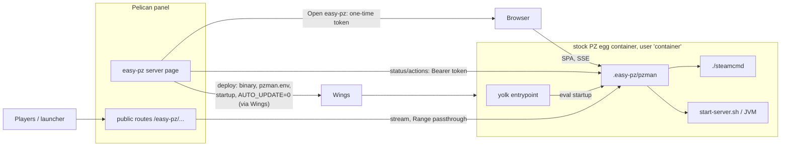

# easy-pz on Pelican

Run easy-pz as an add-on to the stock Pelican Project Zomboid egg: a Pelican
plugin deploys `pzman` into a PZ server created from the stock egg, and Pelican's
login and permissions replace pzman's own. Docker mode (the compose image)
keeps working unchanged.

## Goals

- The stock PZ egg (`pelican-eggs/games-steamcmd`, `project_zomboid`) stays
  unmodified apart from one egg *feature* flag, `easy_pz`.
- All of pzman's Go code is reused; no second implementation of mods, update
  windows or backups.
- Pelican users never log in to pzman: Pelican's session, server ownership and
  subuser permissions decide what they can do in pzman.
- Players reach the public mod page and the launcher endpoints through the
  panel's URL, not through pzman's port.
- Enabling and disabling easy-pz on a server never moves its files: pzman uses
  the stock egg's layout.

Non-goals: rebuilding pzman's UI in Filament (the full UI stays pzman's SPA),
supporting other eggs, arm64 game servers (the egg's game image is amd64-only).

## Architecture

### Runtime facts this plan relies on

Verified in the sources (Wings, the panel, the egg and its yolk image):

- Wings creates the container as `WINGS_UID:GID`, `ReadonlyRootfs: true`,
  `no-new-privileges`, without `fowner`/`dac_override`; only `/home/container`
  (bind) and `/tmp` (tmpfs) are writable. `Tty` and `OpenStdin` are on: the
  Pelican console is the container's stdout, console input is its stdin.
- Wings sets `TZ`, `STARTUP`, `SERVER_MEMORY`, `SERVER_IP`, `SERVER_PORT` and
  the egg's variables; only the primary allocation is passed as env.
- The yolk image (`ghcr.io/parkervcp/steamcmd:debian`) runs
  `tini -g -- /entrypoint.sh`, which runs SteamCMD when `AUTO_UPDATE=1`, then
  `eval`s the startup command in `/home/container`.
- The stock egg: install at `/home/container`, `-cachedir=/home/container/.cache`,
  SteamCMD installed at `/home/container/steamcmd`, stop command `quit` (sent on
  stdin), started when a line contains `SERVER STARTED`, variables
  `SERVER_NAME`, `ADMIN_USER`, `ADMIN_PASSWORD`, `STEAM_PORT`, `MAX_PLAYERS`,
  `SRCDS_APPID`, `SRCDS_BETAID`, `AUTO_UPDATE`.
- A container exit that Pelican did not request is a crash and is restarted
  (`detect_clean_exit_as_crash` defaults to true; no restart within 60 s of the
  previous crash). Pelican's restart waits up to 10 minutes for the stop.
- Plugins: Filament pages gated by `$server->egg->features` (as the Modrinth and
  uMod plugins do), routes, migrations, settings, custom subuser permissions
  (`Subuser::registerCustomPermissions`), Wings file operations
  (`DaemonFileRepository`: `putContent`, `chmodFiles`, `pull`, …).
- Wings file downloads send no `Accept-Ranges`/`Range` support
  (`router_download.go`), so they cannot replace pzman's resumable pack
  downloads.

Measured in Phase 0 (results below):

- PZ reads console commands from `System.in`: what Pelican's console sends
  reaches the game when the game owns the container's stdin.
- Wings caps the install container at max(server memory, `installer_limits.memory`
  = 1024 MiB). A PZ server created with memory 0 (unlimited) gets a broken
  install that the egg still reports as complete.
- The panel image keeps plugins in `/var/www/html/plugins`, outside its
  `/pelican-data` volume; PHP-FPM runs at most 15 workers (`pm.max_children`).
- Requests from the panel container (and any other local client) reach a
  Wings container from `172.18.0.1`, the Wings network gateway.

### Server folder layout (Pelican mode)

| Path in `/home/container` | Owner | Content |
|---|---|---|
| `/` | egg / pzman | game install (`InstallDir`) |
| `.cache/` | game / pzman | Zomboid data dir (`DataDir`): `Server/`, `Saves/`, `db/`, `mods/` |
| `steamcmd/` | egg | SteamCMD (`PANEL_STEAMCMD=./steamcmd/steamcmd.sh`) |
| `.easy-pz/pzman` | plugin | the pzman binary |
| `.easy-pz/pzman.env` | plugin | settings written by the plugin |
| `.easy-pz/pzman.db` | pzman | pzman's database |
| `.easy-pz/backups/`, `cache/`, `logs/`, `steam/` | pzman | backups, mod packs, logs, Steam home |
| `.pelicanignore` | pzman (marked block) | keeps Pelican backups world-only |

### Contract: `pzman.env`

Written by the plugin to `.easy-pz/pzman.env`, next to the binary. pzman reads
the `pzman.env` found in its executable's directory before the environment;
the environment wins, so egg variables always apply. Format: one `KEY=value`
per line, `#` comments and blank lines ignored, values taken verbatim (no
quotes, no expansion); the plugin rejects values containing a newline.

| Key | Meaning |
|---|---|
| `PZMAN_HOST=pelican` | selects Pelican mode |
| `PANEL_PORT` | the server allocation pzman's UI listens on |
| `PZMAN_PELICAN_SERVER` | the server's UUID (token audience) |
| `PZMAN_PELICAN_PUBLIC_KEY` | the plugin's per-server Ed25519 public key |
| `PZMAN_PELICAN_PANEL_URL` | panel origin, for links back and redirects |
| `PANEL_PUBLIC_URL` | `<panel>/easy-pz/<server-id>`: base of the public mod page |
| `PANEL_PUBLIC_GAME_ADDRESS` | node address + game port, for the launcher |

`PZMAN_PELICAN_PUBLIC_KEY` is the 32-byte Ed25519 public key as 64 lowercase
hex characters. The plugin generates the keypair per server
(`sodium_crypto_sign_keypair()`) and keeps the secret key in the panel:
`pzman.env` is readable by any subuser with file, SFTP or backup access, and
such a reader must not be able to mint tokens or sign proxied requests.

### Contract: Pelican tokens

One token format, a JWT signed with Ed25519 by the plugin and verified with
`PZMAN_PELICAN_PUBLIC_KEY`: header exactly `{"alg":"EdDSA","typ":"JWT"}`,
signing input `base64url(header) + "." + base64url(payload)`, signature the
Ed25519 signature of that input, all base64url without padding. Any other
`alg` is refused.

| Claim | Value |
|---|---|
| `iss` | `pelican` |
| `aud` | `pzman:<server uuid>` (a single string) |
| `sub` | Pelican user UUID |
| `name` | Pelican username (audit log, UI) |
| `scp` | array of granted scopes (below) |
| `iat`, `exp` | `exp` ≤ `iat` + 60 s; 30 s of clock skew accepted |
| `jti` | ≥ 16 random bytes, base64url or hex; every token is single-use |

Two deliveries:

1. **Handoff (browser SSO).** The plugin route mints a token and redirects to
   `<pzman UI URL>/auth/pelican#t=<token>[&to=<percent-encoded path>]`. The
   fragment never reaches logs; the SPA posts the token as `{"token": "…"}` to
   `POST /api/auth/pelican` (public), pzman checks signature, `iss`, `aud`,
   `exp` and `jti`, and answers a session token in the body (`token`). The SPA
   keeps it in `localStorage` and sends `Authorization: Bearer <session
   token>` on every API call, then goes to `to` (only a path on its own
   origin: starts with `/`, not `//`, no backslash) or `/`.
   - **No cookies in Pelican mode.** Cookies are shared by every port of the
     node's host, so another tenant's web server on that host would receive
     them; `localStorage` is per origin, hence per port. With no ambient
     credential there is no CSRF check.
   - **One hour, no sliding.** The session (pzman's own HS256 JWT, signed
     with its session secret) ends one hour after the handoff whatever the
     activity, so a permission removed in Pelican applies within the hour. An
     open event stream ends at the expiry of the credential that opened it
     (the session; for a service token, its own `exp`).
     On a 401 the SPA renews silently: it navigates to
     `<panel>/easy-pz/<uuid_short>/open?to=<percent-encoded path>` (exposed as
     `pelicanOpenUrl` by `GET /api/auth/session`); the panel re-checks the
     permissions and redirects back with `#t=…&to=…`.
   - **Tickets.** EventSource and plain download links cannot send headers:
     `POST /api/auth/ticket` (`{"path": …}`) returns a random single-use
     ticket valid 30 s, bound to the session's user, scopes and expiry and to
     that exact path, accepted as `?ticket=` only by the event stream and
     backup downloads; at most 16 live tickets per user (429 beyond). The SPA
     mints one per EventSource (re)connection and per download. pzman never
     logs query strings.

   A new tab, not an iframe: the plugin's page and pzman are different sites.
2. **Service calls (plugin pages).** `Authorization: Bearer <token>` on each
   request from the panel to `/api/*`, minted per request for the acting
   Pelican user, so pzman enforces the same scopes. Each such token is
   single-use; pzman tells them from session tokens by their `alg`.

The pzman UI URL is `http://<node FQDN>:<UI allocation port>` unless the
server page stores an override (a reverse proxy in front of pzman). The panel
uses the same URL for its service calls. The plugin pages read
`GET /api/system` (version, host mode), `GET /api/server/status` and
`GET /api/updates`, and act through the existing operations (`/api/updates/*`,
`/api/server/{restart,save,broadcast,cancel}`, `POST /api/backups`); their
bodies are those of `api/openapi.json`.

### Contract: permissions

The plugin registers a custom subuser permission group `easy-pz`. The server
owner and root admins get every scope; subusers get what is ticked.

| Pelican permission | pzman scope | pzman operations (Huma tags) |
|---|---|---|
| `easy-pz.read` | `read` | every `GET`, the event stream |
| `easy-pz.control` | `control` | `server` (start/restart/save/broadcast/cancel), `updates` |
| `easy-pz.console` | `console` | `console` writes (RCON) |
| `easy-pz.mods` | `mods` | `mods` writes, local mod upload |
| `easy-pz.config` | `config` | `config` writes (ini, sandbox) |
| `easy-pz.backups` | `backups` | `backups` writes and backup downloads |
| `easy-pz.schedules` | `schedules` | `schedules` writes |
| `easy-pz.settings` | `settings` | `system` writes (settings) |

A password session (Docker mode) has every scope. pzman's UI hides what the
session's scopes do not allow; the API refuses it with 403. Least privilege on
top of the table: `GET /api/config/ini` withholds `RCONPassword` (empty,
`redacted`) without `config`, since RCON runs any console command; creating,
updating or running a schedule also needs the scope of its action (`restart`,
`stop`, `save`, `broadcast`: `control`; `backup`: `backups`), so `schedules`
alone cannot restart the server or take backups.

### Contract: public mod page through the panel

The plugin's routes, without login, stream to pzman with `Range`/`If-Range`
passed through and `206` responses passed back:

| Panel route | pzman |
|---|---|
| `/easy-pz/<uuid_short>/mods/<token>/<rest>` | `/mods/<token>/<rest>` |
| `/easy-pz/<uuid_short>/assets/<rest>` | `/assets/<rest>` |

pzman's token check still applies. pzman builds every public URL (page,
`data.json` links, pack and file downloads, page assets) from
`PANEL_PUBLIC_URL` = `<panel URL>/easy-pz/<uuid_short>`, so the launcher works
from the panel URL unchanged (it accepts any path before `/mods/<token>/`).

Each proxied request carries the player's address in `X-Forwarded-For` (one
IP) and `X-EasyPZ-Proxy: t=<unix seconds>,sig=<base64url>`, where `sig` is the
Ed25519 signature (base64url without padding, the plugin's secret key) of
`<t>\n<METHOD>\n<path>` (`path` as pzman receives it, percent-encoding kept,
without the query); pzman verifies it with `PZMAN_PELICAN_PUBLIC_KEY` and uses
`X-Forwarded-For` only when the signature is valid and `t` is within 60 s.

The plugin sends the proxied responses with `Content-Security-Policy: sandbox
allow-scripts allow-downloads allow-popups`, `X-Content-Type-Options: nosniff`
and `Access-Control-Allow-Origin: *`, so owner-controlled content never runs
same-origin with the panel. The page then has an opaque origin: it does not
depend on storage or cookies, and copying falls back to selecting the text.

### Contract: release assets

Each `v*` release carries, next to the launcher's assets:

| Asset | Content |
|---|---|
| `pzman-linux-amd64`, `pzman-linux-arm64` | static pzman binaries, UI included |
| `pzman-SHA256SUMS` | `sha256sum` output for both binaries |
| `easy-pz-pelican-plugin.zip` | the plugin folder `easy-pz/`, versioned |
| `pelican-plugin-update.json` | `{"*": {"version": …, "download_url": …}}` for one-click updates |

The plugin's `update_url` is
`https://github.com/magne4000/easy-pz-docker/releases/latest/download/pelican-plugin-update.json`.
The packaged plugin pins the pzman version of its own release; the
`EASYPZ_PZMAN_BASE_URL` plugin setting replaces the release download URL
(a directory holding `pzman-linux-amd64` and `pzman-SHA256SUMS`) for
development and tests.

## Phases

Phase 0 is done. Phases 1–2 (Go) and 3 (PHP) can run in parallel: they only
meet at the contracts above.

### Phase 0: results (2026-10-19)

Checks 1, 2 and the Linux half of 5 ran on a GitHub-hosted x86 runner (4 CPUs,
Docker 28.0.4) with the Pelican compose (panel and Wings `v1.0.0-rc.1`) and
the stock egg, from a temporary branch; checks 3, 4 and the Mac half of 5 on
OrbStack. The scripts and the probe plugin were throwaway and are not in the
repo.

- [x] **1. Stock egg.** Works once the server has a memory limit.
  - With 6144 MiB: installed in 159 s (7.2 GB); `SERVER STARTED` 51 s after
    Start, Wings `running`.
  - `players` typed in Pelican's console → `Players connected (0)` in the
    console: PZ reads `System.in`.
  - Stop sends `quit` → world saved, exit 0 in 10 s, Wings `offline`, no crash
    handling. Restart → started again in 61 s.
  - With memory 0, the installer is capped at 1024 MiB: SteamCMD was killed at
    47 % of the download, the egg still printed "Installation completed", and
    Start failed on the missing `ProjectZomboid64`.
  - The launch JSON's default heap is `-Xmx8g`.
- [x] **2. Unmodified pzman in the egg container.** Everything works except the
  console.
  - Startup command `set -a; . ./.easy-pz/pzman.env; set +a; exec ./.easy-pz/pzman`
    with the paths of the layout table in `pzman.env`.
  - Runs as uid 568 on the read-only root filesystem; no missing library; no
    warning or error logged.
  - The egg's SteamCMD with `STEAM_PLATFORM=linux64` installed and updated the
    game (it completed the broken install of the memory-0 run) and downloaded a
    Workshop item in non-Steam mode. The game reached `running` 127 s after
    login; the panel container reached pzman's port.
  - Gaps: Pelican's console shows pzman's JSON logs, never the game's lines, so
    Wings stays `starting`; console input reaches the container but nothing
    reads it; Pelican's Stop (`quit`) does nothing and Wings stays `stopping`
    until Kill. SIGTERM → clean shutdown, exit 0 in 8 s, Wings `offline`.
- [x] **3. Plugin skeleton.** Works.
  - The page answers 403 until the egg has `easy_pz`, then shows.
  - The `Subuser::registerCustomPermissions` group appears in the subuser
    editor. The owner gets every scope; a subuser with `easy-pz.read` sees the
    page without the action; a subuser without it gets no page.
  - `putContent` of a 20 MiB binary arrived intact (SHA-256 match),
    `chmodFiles` set 0755, `StartupModificationService` set the startup command
    and `AUTO_UPDATE=0`; the deployed script ran as uid 568.
  - The permission labels show raw translation keys without a language file.
  - With `panel/plugins` bind-mounted on `/var/www/html/plugins`, the plugin
    survived a recreate of the panel container.
- [x] **4. Streaming through the panel.** Works, with a cap.
  - 1 GiB through a plugin route: 391 MiB/s (1534 MiB/s direct), PHP-FPM worker
    ≤ 95 MiB, SHA-256 match.
  - `Range` → 206 with the right bytes; a download cut at 200 MiB and resumed
    with `curl -C -` gave an identical file.
  - The panel's `/login` stayed at 0.03 s with up to 14 downloads running and
    hung from 15 on (the 15 PHP-FPM workers). Aborted downloads free their
    worker.
- [x] **5. Reachability and client IP.** The panel container reaches
  `<host IP>:<allocation>` (Linux and OrbStack). A Wings container sees the
  panel, the host through `127.0.0.1` and other containers as `172.18.0.1` (the
  Wings network gateway, through Docker's userland proxy); on OrbStack every
  client does. Only the host reaching its own IP kept its address.

What changed in the plan:

- Phase 1: console input goes to the game's stdin, not RCON.
- Phase 2: the client IP of proxied requests comes from a header signed by the
  plugin, not from a trusted proxy address (every local client is `172.18.0.1`).
- Phase 3: a language file for the permission labels; a cap of 5 concurrent
  proxied downloads; Enable warns when the server has no memory limit.
- Phase 4: the compose mounts the panel's plugins directory; the docs ask for a
  memory limit on PZ servers.

### Phase 1: pzman Pelican-mode runtime (Go)

- [x] Mode: `PZMAN_HOST=pelican` (from the environment or `pzman.env`); docker
      mode is the default and unchanged.
- [x] `pzman.env` loading, environment wins; validation reports both sources.
      Each configuration error names the variable's source (`the environment`,
      the `pzman.env` path, `SERVER_PORT from …`, `derived from SERVER_MEMORY`).
- [x] Path defaults from the layout table; `PANEL_STEAMCMD=./steamcmd/steamcmd.sh`.
      The root is the parent of the executable's directory; a relative path
      value is resolved against it; logs go to `PANEL_LOG_DIR`
      (`.easy-pz/logs`); `STEAM_PLATFORM=linux64` unless set.
- [x] Non-root: skip the boot ownership fix (`boot.go`, `FixOwnership` loop);
      PUID/PGID ignored (credential switching is already skipped when not root).
- [x] Egg aliases: `SERVER_PORT`→`DEFAULT_PORT`, `STEAM_PORT`→`UDP_PORT`,
      `ADMIN_USER`→`ADMIN_USERNAME`, `SRCDS_BETAID`→`SERVER_BRANCH`; heap from
      `SERVER_MEMORY` (MiB, with headroom) when `MEMORY_XMX_GB` is unset and the
      limit is not 0. One documented precedence order, tested.
      Order (`internal/app/pelican.go`): environment > `pzman.env` > egg alias
      or derived heap > layout default > built-in default; a pzman variable set
      anywhere beats its egg alias (empty counts as unset when the variable has
      a built-in default). Heap: `max(1, floor(SERVER_MEMORY × 0.75 / 1024))`
      GiB (6144 MiB → 4 GiB).
- [x] Console: every console-ring line (game, `[steamcmd]`, pzman events) also
      to stdout as plain text; pzman's JSON logs to `.easy-pz/logs/` instead of
      stdout. `pzman.log`, rotated to `pzman.log.1` at start above 10 MiB.
      Pelican also shows stderr: libraries' stderr output (and the standard
      `log` package) goes to `pzman.log` too (Phase 2 follow-up).
- [x] stdin: `quit` (the egg's stop command) runs pzman's shutdown (save, quit,
      await JVM) and exits 0; any other line goes to the game's stdin, which
      PZ reads (`System.in`); its reply reaches the console through the
      mirrored game lines. The supervisor already holds that stdin pipe.
      With the game not running, a `[pzman]` console line says so; EOF on
      stdin only stops reading.
- [x] Lifecycle: no pzman action leaves the container running with the game
      stopped; Stop in the UI and the `stop` schedule action are hidden in
      Pelican mode. Fatal boot errors exit non-zero (Wings' crash handling).
      `POST /api/server/stop` answers 409; creating or updating a `stop`
      schedule answers 422; existing ones are not registered (warning logged).
      `GET /api/system` has `host` (`docker` | `pelican`), `eggAutoUpdate`,
      `memoryXmxGB`, `gamePort`, `udpPort`.
- [x] `.pelicanignore`: maintain a marked block excluding the game install,
      `steamcmd/`, `.easy-pz/backups/`, `.easy-pz/cache/`, `.easy-pz/steam/`.
      Also `.easy-pz/logs/`; patterns are anchored at the root (`/media/`), so
      a mod's `media/` under `.cache/` stays in the backup.
- [x] Warn in the UI when `AUTO_UPDATE=1`: the yolk's boot-time update bypasses
      the game version lock.
- [ ] Release: static `pzman-linux-amd64` (and `-arm64` for local development)
      plus `pzman-SHA256SUMS` attached to each `v*` release (release assets
      contract above).

Done when, on the stock egg: Pelican's Start reaches `SERVER STARTED`; `players`
typed in Pelican's console prints the reply; Stop saves and exits 0; an update
window restarts PZ while Pelican keeps showing the server running.

### Phase 2: pzman auth and public URLs for Pelican (Go + SPA)

- [x] Token verification (EdDSA, `iss`, `aud`, `exp` ≤ 60 s, clock skew),
      single-use `jti` store for handoffs.
      Every token (handoff and bearer) is single-use; the in-memory store keeps
      a `jti` until `exp` + 30 s and fails closed past 10 000 live entries.
      `iat`, `exp`, `scp` (an array) and a `jti` of 22–128 base64url/hex
      characters are required; unknown scopes are ignored (a newer plugin may
      grant scopes this pzman lacks). Go tests pin the plugin's own vectors.
- [x] `POST /api/auth/pelican` (handoff → session with scopes, username from
      `name`); SPA route `/auth/pelican` reads the fragment and posts it.
      A token without `read` gets 403. `GET /api/auth/session` has `username`
      (was `user`), `scopes`, `host` and, on Pelican, `pelicanPanelUrl` and
      `pelicanOpenUrl` (renewal).
- [x] Bearer authentication for service calls; CSRF check skipped for Bearer.
      Pelican mode sets no cookie and has no CSRF check at all: the SPA's
      session is a bearer too (token contract above), with tickets for the
      event stream and downloads.
- [x] Scopes in the session; per-operation enforcement from Huma tags + method
      (table above); 403 with a clear message; SPA hides what is not allowed.
      `GET /backups/{id}/download` needs `backups` (operation metadata); a
      test walks every registered operation against the table. Writes of
      Mods' "update when empty" buttons call `/updates/*`: `control`.
- [x] Pelican mode: password login disabled, `PANEL_ADMIN_PASSWORD_HASH` not
      required; the login page says to open easy-pz from Pelican, with a link to
      `PZMAN_PELICAN_PANEL_URL`.
- [x] Public URLs: `PANEL_PUBLIC_URL` may carry a path in Pelican mode; page
      assets, `data.json` links, pack and file downloads all derive from it.
      Links are path-absolute under that path (Docker output unchanged);
      `mods.html` gets its `/assets/` URLs prefixed and its favicon inlined
      when served.
- [x] Client IP behind the panel: every local client, the panel included,
      reaches pzman from `172.18.0.1` (Phase 0), so an address-based trusted
      proxy cannot tell the panel from anyone else. The plugin signs each
      proxied request (Ed25519 over method, path and
      a timestamp, in a header); pzman takes `X-Forwarded-For` only from signed
      requests, so per-IP limits apply to players.
      In Pelican mode Fiber's `ProxyHeader` is off: `X-Forwarded-For` counts
      nowhere else.
- [x] Audit: actions logged with the Pelican username.
      Every Pelican write (`pelican action`, with status) and every refusal
      (`pelican action refused`) goes to `pzman.log`.

Done when: a forged, expired, replayed or wrong-server token is refused; a
token with `read` only cannot change anything; the mod page and launcher work
from a URL with a path prefix.

### Phase 3: the `easy-pz` Pelican plugin (PHP, new `pelican-plugin/` folder)

- [x] `plugin.json`: `panel_version` pinned to the tested panel, `api_version: 1`,
      `update_url` to the release's `pelican-plugin-update.json`; the release
      packages the plugin zip and that file (release assets contract).
      `panel_version` is `^1.0.0-rc.1`: the panel compares with
      `version_compare`, so `^1.0.0` would refuse `1.0.0-rc.1`. The workflow
      `pelican-plugin.yml` checks the plugin (`php -l`, PHPUnit on the
      framework-free classes) and, on `v*` tags, sets the plugin version and
      the pinned pzman version from the tag.
- [x] Migration: `easy_pz_servers` (server id, encrypted secret, deployed pzman
      version, UI allocation id, enabled). The secret is the server's Ed25519
      secret key (`signing_key`, hex, encrypted with the app key); it is kept
      across Disable and re-Enable. `pzman.env` gets only the public key, so
      file, SFTP or backup access to the server cannot sign tokens.
- [x] Permissions: register the `easy-pz` group (table above) with a
      `translation_prefix` and a language file for its labels.
- [x] Server page *Easy PZ*, visible when the egg has `easy_pz`:
  - not enabled (admins): pick the UI allocation among the server's
    allocations; Enable;
  - enabled: status (pzman state, game build, players, update window, pending
    mod updates) and actions (check updates, open/cancel the update window,
    restart with countdown, save, broadcast, backup now), each shown only with
    the matching permission, all through service calls;
  - *Open easy-pz*: handoff in a new tab;
  - admins: Upgrade (when the plugin pins a newer pzman), Disable.
  - The host mode shown comes from the `host` field of `GET /api/system`.
  - Versions are compared with a leading `v` stripped (pzman reports
    `v1.2.3`, the plugin pins `1.2.3`).
  - *Open easy-pz* runs behind the panel pages' session checks too:
    `AuthenticateSession` (ends with a password change) and
    `RequireTwoFactorAuthentication`.
  - A UI allocation no longer assigned to the server (an owner can detach
    it) counts as missing: no service call, handoff or proxied request goes
    to that port.
- [x] Enable (warns first when the server has no memory limit: no heap to
      derive, and the stock egg's install is capped at 1024 MiB):
  1. generate the secret; write `.easy-pz/pzman.env` (`putContent`);
  2. download the pinned `pzman-linux-amd64` in the panel, verify it against
     `pzman-SHA256SUMS`, `putContent` it to `.easy-pz/pzman`, `chmodFiles` 0755
     (Wings' `pull` cannot verify a checksum);
  3. startup command `./.easy-pz/pzman`, `AUTO_UPDATE=0`
     (`StartupModificationService`); restart the server.
  - The binary goes to `.easy-pz/pzman.next`, then replaces `.easy-pz/pzman`
    by unlink + rename: a running executable cannot be written over and Wings
    refuses to rename onto an existing file.
  - `StartupModificationService` rewrites every egg variable (missing ones
    become empty): the plugin passes all current values.
- [x] Disable: restore the egg's startup command and `AUTO_UPDATE=1`; keep the
      data and `.easy-pz/` (re-enable resumes). Restores the startup command
      and `AUTO_UPDATE` saved at Enable (the stock egg defaults it to 0).
- [x] Upgrade: redeploy the binary; applied at the next restart, or ask pzman
      to open an update window. The Upgrade dialog offers Pelican's restart.
- [x] Refuse to enable when the egg no longer matches the assumptions (stop
      command `quit`, `-cachedir=/home/container/.cache` in its startup,
      `SRCDS_APPID=380870`).
- [x] Public routes `/easy-pz/{server}/mods/{token}/{path?}`: streaming proxy
      with `Range`, no session, the signed client-IP header, time limit off. At
      most 5 proxied downloads at once across the panel (configurable; the
      panel's 15 PHP-FPM workers are all taken at 15); beyond that, `429` with
      `Retry-After`, which the launcher already waits out (`pzclient.do`).
      The slots are cache locks (TTL 120 s, refreshed while streaming). The
      signed path is the one sent to pzman, percent-encoding kept, without the
      query; paths with dot segments get 404. pzman's own `Retry-After` is
      passed back too. The mods route also takes the launcher's
      `POST files/<id>` (body and `Content-Type` forwarded). Every proxied
      response carries `Content-Security-Policy: sandbox allow-scripts
      allow-downloads allow-popups`, `X-Content-Type-Options: nosniff` and
      `Access-Control-Allow-Origin: *`, over pzman's values: the content comes
      from a binary the server owner can replace, so it must not run with the
      panel's origin.

Done when, on a fresh x86 Pelican: a stock PZ server gets easy-pz in one click;
the owner opens easy-pz without logging in; a subuser with only
`easy-pz.read` sees but cannot change; a player installs the mod set through
the panel URL with the launcher, including a resumed download; Disable returns
to the stock egg with the world intact.

### Phase 4: migration, docs, end-to-end

- [ ] Migration from the compose deployment: `files/` → server root, `data/` →
      `.cache/`, `backups/` → `.easy-pz/backups/`, `chown -R 568:568`;
      allocations 16261 and 16262 plus the UI port. Before that, check whether
      `pzman.db` stores absolute paths (`/project-zomboid…`); if so, a one-time
      rewrite at first Pelican boot.
- [ ] End-to-end on x86 (CI branch or the NAS): Pelican compose + plugin + stock
      egg + Enable + mod install + update window + launcher download + Stop.
- [ ] Pelican compose in the docs: mount `panel/plugins` on
      `/var/www/html/plugins` (the panel image does not keep plugins otherwise).
- [ ] README: a Pelican section (egg feature, plugin install, Enable,
      permissions, migration, a memory limit on PZ servers).

### Local development loop (Apple Silicon)

The egg's game image is amd64-only, but pzman has fake drivers
(`PANEL_DRIVERS=fake`). The Pelican compose from the smoke test runs on
OrbStack; a server from any arm64-capable egg running `pzman-linux-arm64` in
fake mode exercises the plugin, the handoff, permissions and the public proxy
without PZ. The real game path is tested on x86 only.

## Risks and open questions

- Pelican's plugin system is "still in development" (panel v1.0.0-rc.1): pin
  `panel_version`, expect fixes on panel upgrades.
- Upstream changes to the stock egg break the assumptions; the Enable check
  above turns that into a clear refusal instead of a broken server.
- Proxied downloads hold a PHP-FPM worker each (Phase 0: ≤ 95 MiB, 391 MiB/s);
  the cap of 5 leaves the panel 10 workers. With many players downloading at
  once, they queue; if that is too slow, redirect pack downloads to pzman's
  port with a short-lived signed URL (that port then has to be reachable by
  players again).
- pzman's UI port stays a server allocation reachable by Pelican users'
  browsers; players no longer need it.
- A PZ server created with memory 0 gets a broken stock install that reports
  success. pzman repairs it at its first start (Phase 0, check 2), but the
  stock egg alone does not: the docs ask for a memory limit.
- Internal restarts (update windows, scheduled restarts) are invisible to
  Pelican's state: it shows the server running while PZ restarts.
